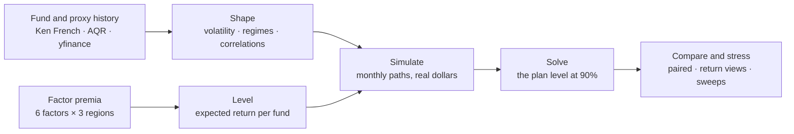
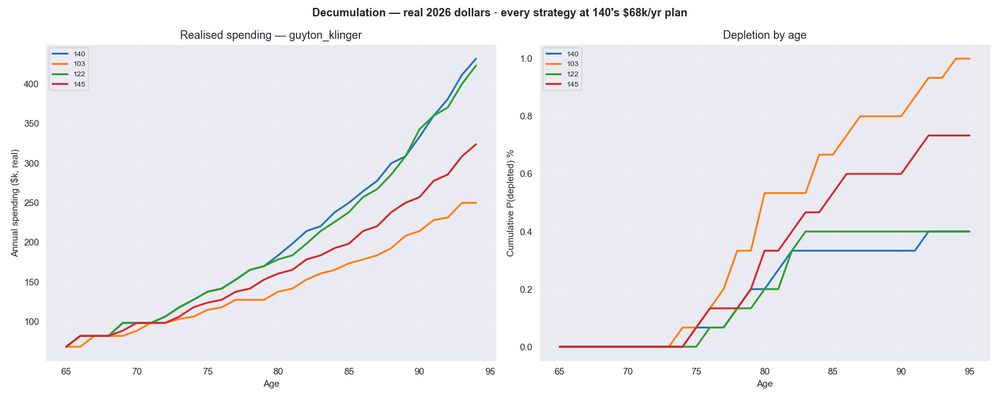

# Monte Carlo Portfolio Analysis

A retirement simulator for long horizons (25–60 years) that answers two
questions: **how much can you spend**, and **which portfolio should you hold?**

It starts from a fact most simulators skip: nobody knows a fund's expected
return. A century of US market data still leaves the market premium's 95%
interval 7 percentage points wide. So the model does not read expected returns
off each fund's history. It builds them from a few stated factor premia, then
checks whether each answer survives those premia being wrong.

**v3.5 (October 2026)** · Python 3.10+ · MIT · every figure in real (today's) dollars

## What it answers

The interactive runner (`python3 run.py`) offers three questions. Each is named
by what it varies:

| Question | What varies | What stays fixed | Answer |
|---|---|---|---|
| **Portfolios** | portfolios, bond sleeves, glide paths | your plan | a paired head-to-head at one plan, then the same comparison under four other return models |
| **Retirement choices** | retirement age, claiming age, savings, withdrawal rule | one portfolio | each option solved and compared with your current plan on the same paths |
| **Market & life assumptions** | returns, cash rate, inflation, lifespan, care costs | everything you choose | how far the figures move, and whether anything changes the portfolio ranking |

## How it works



1. **Shape comes from history.** Each of the 27 funds is spliced onto academic
   factor data and scored proxy funds, some back to 1963. From that history the
   model takes what history measures well: volatility, three volatility regimes
   per fund (a monthly Markov chain tied to the market's own regime), and a
   correlation matrix for each market regime. Correlations rise in crises: US
   against developed markets goes from 0.65 to 0.91, and 326 of 351 fund pairs
   rise with it.
2. **Level comes from factor premia.** A fund's expected return is the cash
   rate plus its factor loadings times the premia, minus its fees and trading
   costs. The loadings (market, size, value, profitability, investment and
   momentum, in US, developed and emerging markets) are fitted on the real
   fund's own returns. The premia are measured on decades of factor data. Bonds
   earn cash plus their measured spread. A single stock earns its loadings plus
   an edge you state (zero by default), never the history that got it picked.
   `python3 tools/estimability.py` shows why: sampling more often pins down
   volatility, but only calendar time pins down a mean.
3. **Simulate.** Monthly paths cover your whole life: contributions,
   retirement, Social Security, an optional care-cost shock, glide paths and
   four withdrawal rules (`constant_real`, `guyton_klinger`, `vpw`,
   `fixed_pct`). Each path also draws its own estimation error. That error flows
   through the premia the funds share, so a portfolio cannot diversify it away.
4. **Solve.** The solver finds the largest spending plan that holds at 90%
   confidence. Holding means every rolling 10-year stretch averages at least 85%
   of the plan, so a lean first decade cannot be repaid by a rich ninth.
5. **Compare and stress.** Every strategy runs on the same simulated markets
   and is read at one plan, so a difference between two comes with an interval
   that means something. The comparison then repeats under four other return
   models: international keeps lagging, international catches up, no factor
   premia, and each fund's own history. It reports the portfolio that gives up
   least across all five. The sensitivity tool sweeps 24 assumptions and says
   whether each one moves the spending level or reorders the portfolios.

Every run is saved with its provenance. `python3 run.py --diff` explains why a
result changed, and `--spec` replays a run without the prompts.

The details are in [docs/METHODOLOGY.md](docs/METHODOLOGY.md), including the
[expected-returns chapter](docs/METHODOLOGY.md#expected-returns).

## Quickstart

```bash
python3 -m pip install -r requirements.txt
```

```bash
python3 data_collection_regime_model.py
```

```bash
python3 tools/validate_all.py
```

```bash
python3 run.py
```

1. The install pulls numpy, scipy, pandas, yfinance and matplotlib.
2. `data_collection_regime_model.py` downloads market data and builds `output/`.
   It takes about 10 minutes and needs a network connection.
3. `validate_all.py` runs the structural, data and behaviour checks. Every check
   must pass.
4. `run.py` starts the interactive runner. Open **Your details** first to enter
   your age, accounts and Social Security. They are saved to
   `config/investor.json`, which is gitignored.

Until you enter your details, runs use a placeholder investor (age 37, $300k
across five accounts) and print a warning saying so. Every prompt has a
default, so a typical run is mostly pressing Enter. `python3 run.py --again`
repeats the last run.

## Sample output

The placeholder investor (age 37, $300k, retiring at 65, planning to 95) under
`guyton_klinger`, comparing four all-equity portfolios from the
[library](portfolios/portfolio_templates.csv):

- **140**: a factor-tilted base (VOO, AVUV, VFMO, Avantis international, 5% COST)
- **122**: an Avantis factor tilt with no single stock
- **145**: 140's shape in plain Vanguard funds
- **103**: a two-fund index portfolio, VTI 70 / VXUS 30

Each is first solved for its own plan level, then all four are read at 140's
$68k plan on the same paths:

```
    how much MORE lifetime average spending than 140, per year,
    every strategy at one plan ($68k/yr)
    strategy                         low     high         % of base   verdict
    ------------------------------------------------------------------------------
    103                           -61.3k   -50.4k  -30.0% .. -24.7%   WORSE
    122                            -6.2k    +3.3k    -3.0% .. +1.6%   not resolved
    145                           -38.8k   -29.7k  -19.0% .. -14.5%   WORSE
```

Then the same comparison under each return model. A cell is the lifetime
spending that portfolio gives up against the best one in that view; `~` marks a
gap the paired paths cannot separate from zero:

```
    strategy       factor  intl lags intl gains no factors historical      worst
    ----------------------------------------------------------------------------
    140              best      ~1.0%      ~0.1%      ~0.5%       best       1.0%  ←
    103             26.9%      25.9%      26.5%      ~0.9%      35.7%      35.7%
    122             ~0.2%       best       best      ~0.7%      14.5%      14.5%
    145             16.1%      17.4%      17.6%       best      10.6%      17.6%

    ✓ 140 is never resolved behind the best, so it holds up in every view.
    ← Smallest worst case: 140, at most 1.0% behind (intl lags). That is the
      minimax-regret pick, the answer if you cannot say which view is true.
```

Read the `no factors` column: if the factor premia pay nothing, every portfolio
ties. The tilt costs little if the premia vanish and pays a lot if they do not.
The full report also breaks spending down by decade of retirement, with a low
case for each, and draws the same runs:



Spending rises because `guyton_klinger` raises it as the portfolio grows. The
right panel is the share of paths that ran out, in percent: at most 1% for any of
the four.

## What it has found

These results were measured on one investor's plan and this repo's portfolio
library. Your levels will differ; the shape of each result is the useful part.
Each is set out with its evidence in [docs/RESULTS.md](docs/RESULTS.md).

- **Most uncertainty changes how much you can spend, not which portfolio is
  best.** 22 of 24 assumption sweeps move only the spending level. The real cash
  rate swings it 4.3x and the factor premia 1.6x.
- **The factor tilt is an asymmetric bet.** At full factor premia a tilted
  portfolio leads the same shape in cheaper Vanguard funds by 13–16% of
  lifetime spending; at zero premia the Vanguard one edges ahead by up to 3%.
- **Bonds cost spending under flexible withdrawals.** A permanent 10% bond
  sleeve from 65 costs 7–10% of lifetime spending under Guyton-Klinger, and
  neither TIPS nor Treasuries change that.
- **Rank on spending by life stage, never on the plan level.** Ranking on the
  plan level produced five false reversals before the reports were changed.

## Using it with Claude Code

The repo is set up for [Claude Code](https://claude.com/claude-code): open the
folder and ask in plain English. `.claude/CLAUDE.md` gives Claude the
architecture, and these skills give it the procedures:

| Skill | What it does |
|---|---|
| `/setup-portfolio` | Swap the fund universe for your own funds and build sample portfolios |
| `/add-ticker` | Add or remove a single fund |
| `design-runs` | Turn a question ("what if I retire at 60?") into a reproducible `run.py --spec` command, and read the result |
| `refresh-parameters` | The quarterly data refresh, and what a drift failure means |
| `engine-change` | Change the simulation without breaking determinism or the golden masters |
| `verify-test` | Check that a new test can actually fail |
| `remeasure` | Find every place a measured number lives after something moves it |

The manual procedure for changing funds is in
[docs/CUSTOMIZING.md](docs/CUSTOMIZING.md).

## What it is not

- **Not a forecast.** Every spending level is conditional on the factor
  premia, the weakest input there is. Use the return views and the sensitivity
  sweeps to see how far the levels move; trust the comparisons more than the
  levels.
- **Not tax-aware.** The engine models one pooled portfolio. Taxes were
  measured to change the level but not the portfolio decision.
- **Not a couple.** The model is one person, so it cannot see a survivor
  benefit, which makes delaying Social Security worth more in a couple.
- **Not your fund list.** The 27 funds reflect one investor's accounts. The
  comparisons are only as relevant as the funds you can actually hold;
  `/setup-portfolio` swaps them.
- **Not advice.** See the disclaimer below.

## Documentation

| Doc | What's in it |
|---|---|
| [docs/GUIDE.md](docs/GUIDE.md) | Running the model: workflow, your details, how many paths, reading the output, troubleshooting |
| [docs/METHODOLOGY.md](docs/METHODOLOGY.md) | The fund universe, regimes, correlations, history splicing, expected returns, parameter uncertainty, validation |
| [docs/RESULTS.md](docs/RESULTS.md) | What the model has concluded, and how firmly |
| [docs/ERD.md](docs/ERD.md) | Every file, record and registry the engine passes between its parts |
| [docs/CUSTOMIZING.md](docs/CUSTOMIZING.md) · [docs/RUNBOOK_tickers.md](docs/RUNBOOK_tickers.md) | Changing the fund universe |
| [CHANGELOG.md](CHANGELOG.md) | Version history |
| [.claude/CLAUDE.md](.claude/CLAUDE.md) | Architecture notes, written for AI coding agents |

## License & disclaimer

[MIT](LICENSE). This is a personal research project, not investment advice.
Simulations rest on historical data and assumptions, and actual returns may
differ substantially. Consult a qualified advisor before making financial
decisions.
