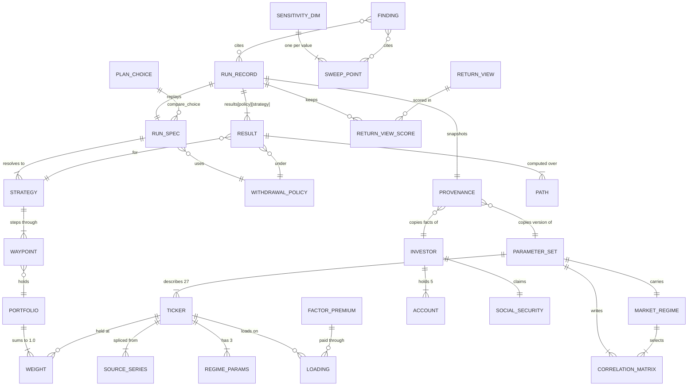
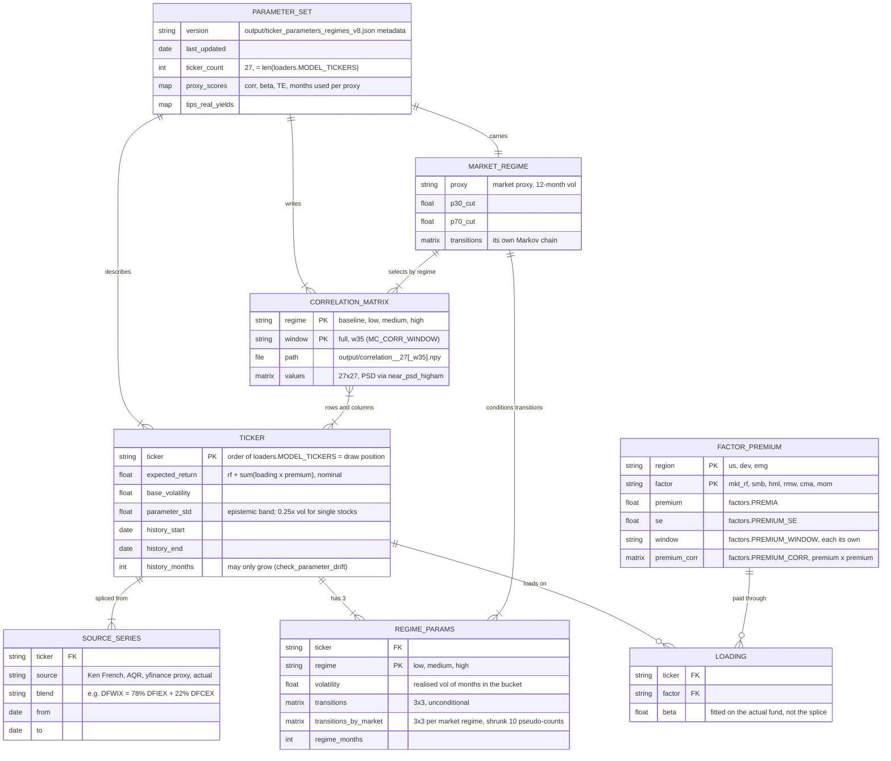
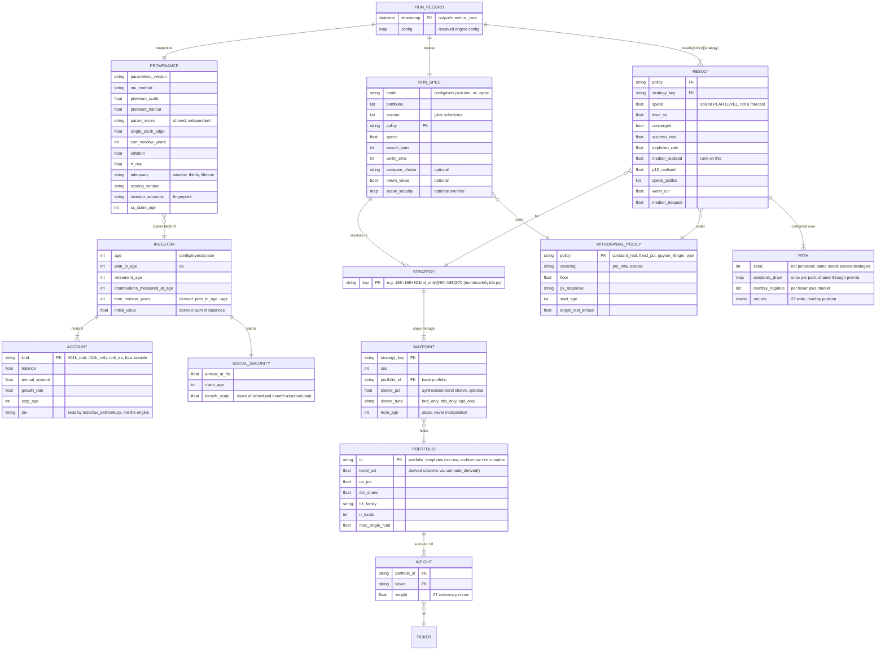
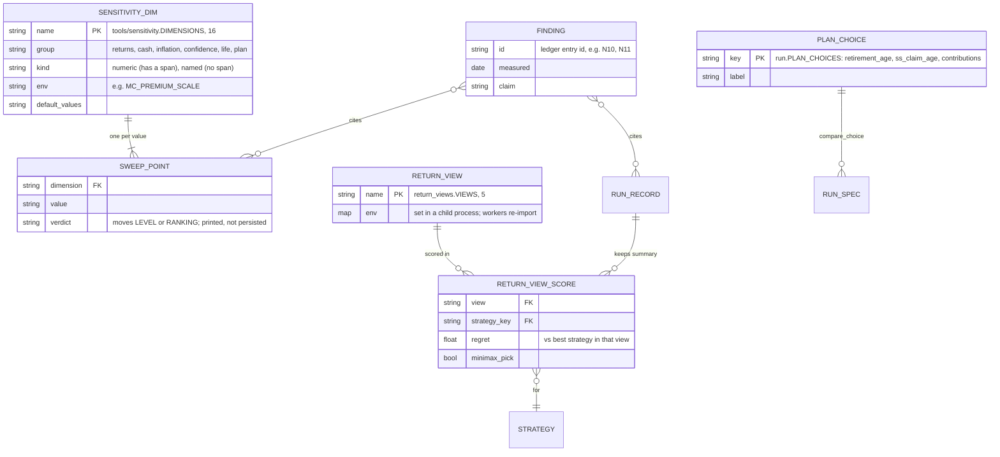

# Monte Carlo Data Map

How the simulation's data fits together. There is no database: every entity is
a file, a CSV row, a key in a JSON record, or a registry in code, and each
diagram's comments say which.

## Overview

All 27 entities without their attributes. Each layer below repeats its part
with attributes and the file or registry it lives in.

## Market layer

Regenerated each quarter by `data_collection_regime_model.py` into `output/`.
The ticker list sets the order of every matrix row and every random draw.

## Plan, portfolio and run

Your facts come from `config/investor.json` and portfolios from
`portfolio_templates.csv`. A run resolves them into strategies and writes one
record to `output/runs/`.

## Analysis layer

The tools that fan out to many evaluations. Sweep points are printed but not
saved. Return-view scores are saved inside the run record.

## What holds it together

- **MODEL_TICKERS is the root key.** Correlation order, CSV columns, JSON keys
  and the position of each random draw all follow it.
  `tools/check_consistency.py` checks that they agree.
- **The strategy key is the glide.** A key such as
  `168>168+30:bnd_only@60>168@70` spells out the waypoints and also indexes
  `results`, so there is no separate glide table.
- **Provenance copies, it does not reference.** The investor file and the
  parameters can change after a run. The record keeps the values that run used,
  which is how `run.py --diff` explains a change.
- **Paths are never stored.** Pairing still rests on them. Every result in a
  run, and every return view, uses the same seeds and draws across all 27
  tickers.
